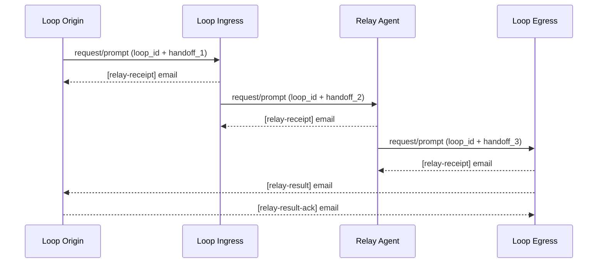

---
metadata:
  skill_invocation_notation: >
    Top-level skill entrypoints use SKILL.md. Parent-scoped subskill entrypoints use
    SKILL-MAIN.md and are loaded explicitly through their parent; nested SKILL.md is
    accepted only as legacy input when SKILL-MAIN.md is absent.
    Skill and subskill entrypoints use bare object paths: `X` invokes skill X and
    `X->Y->Z` invokes subskill Z. Subcommands use parenthesized components:
    `X->cmd()` invokes a direct subcommand, `X->Y->cmd()` invokes a subcommand of
    subskill Y, and `X->parent()->child()` invokes child subcommand child exposed
    by parent subcommand parent. Intermediate subcommands act as object generators.
    Forms such as `X()` and `X->Y()` are invalid for skill or subskill entrypoints.
---

# Ordered Forward Relay Loop (`relay-loop`)

Alias: `relay-loop-via-gateway-and-mailbox`.

## Workflow

1. **Confirm forward-relay topology fit**: one `loop origin` initiates an ordered lane (`loop origin -> loop ingress -> relay agent(s) -> loop egress`) sharing `loop_id` with a hop-specific `handoff_id`, and `loop egress` emails the final result directly back to `loop origin` (escalate to `houmao-agent-loop-lite` or `houmao-agent-loop-pro` `generic-loop` for fan-out, multi-lane graphs, or generated run control).
2. **Persist the local hop ledger row first** using the schema, timing fields, and single-reminder supervision rules in [../references/shared-loop-ledger-and-resend.md](../references/shared-loop-ledger-and-resend.md).
3. **Dispatch the downstream hop** via `houmao-shared-routines->houmao-agent-messaging` (`agents single ... request --text` under `agent-requester` default or `agents single ... prompt` under `agent-operator`; or `houmao-cccc chat send --operation-id` when operating a CCCC group relay without mixing channels), arm the single repeating `[relay-supervisor]` reminder via `houmao-shared-routines->houmao-agent-gateway`, and **end the turn immediately**.
4. **Execute receiver and egress rules on each hop**:
   - Deduplicate `(loop_id, handoff_id)`; if already seen, resend the matching receipt or final result without re-forwarding downstream work.
   - Persist ownership and send `[relay-receipt]` to the **immediate upstream sender** via `houmao-shared-routines->houmao-agent-email-comms` (even when acting as `loop egress`, so the upstream relay learns the hop arrived).
   - Intermediate `relay agent`: mint a new hop `handoff_id` under the same `loop_id`, dispatch to the next hop, and arm supervision.
   - `loop egress`: send `[relay-result]` to `loop origin` and retain follow-up until `[relay-result-ack]` arrives from `loop origin`.
5. **Run supervisor reviews** per [../references/shared-loop-ledger-and-resend.md](../references/shared-loop-ledger-and-resend.md) (mailbox first -> `houmao-agent-inspect` peek -> last-resort probe -> resend with the **same** `loop_id` and `handoff_id`), then stop.

If the request does not map cleanly to these steps, use the native planning tool to build a step-by-step plan from [../references/shared-loop-ledger-and-resend.md](../references/shared-loop-ledger-and-resend.md), the templates below, and the user request, then execute the plan.

## End-to-End Relay Flow



## Message and Reminder Templates

### Downstream Handoff (`request --text` or `prompt`)

```text
Loop role: <loop ingress | relay agent | loop egress>
Action: Take ownership of handoff `<handoff_id>` in loop `<loop_id>`.
Upstream sender: <identity + mailbox> | Loop origin: <identity + mailbox> | Next hop: <identity or "you are loop egress">
Required receipt: Send `[relay-receipt] loop=<loop_id> handoff=<handoff_id>` to `<upstream sender>` after persisting ownership.
If loop egress: Also send `[relay-result] loop=<loop_id> result=<result_id>` to `<loop origin>` and await `[relay-result-ack]`.
Ledger & timing: Record loop_id, handoff_id, upstream/downstream, phase, next_review_at=<...>, receipt_due_at=<...>, result_due_at=<...>, max_attempts/give_up_at=<...>.
```

### Receipt, Final Result, Ack, and Supervisor Reminder

- **Receipt**: `Subject: [relay-receipt] loop=<loop_id> handoff=<handoff_id>` — sent to immediate upstream sender confirming persisted ownership and `next_review_at`.
- **Final result**: `Subject: [relay-result] loop=<loop_id> result=<result_id>` — sent by `loop egress` to `loop origin` with result summary and last `handoff_id`.
- **Result ack**: `Subject: [relay-result-ack] loop=<loop_id> result=<result_id>` — sent by `loop origin` to `loop egress` closing follow-up.
- **Supervisor reminder**: `Title: [relay-supervisor] review active relay handoffs` (`mode: repeat`, single reminder per agent) — reopen ledger, check mail first, peek due downstream agents via `houmao-shared-routines->houmao-agent-inspect`, resend only unconfirmed overdue hops reusing `(loop_id, handoff_id)`, and stop.

## Guardrails

- DO NOT wait or poll inside a live turn for downstream receipts or final results, or mint a fresh `handoff_id` when resending the same hop.
- DO NOT rely on email thread ancestry alone instead of explicit `(loop_id, handoff_id)` correlation, or skip the egress-to-upstream `[relay-receipt]`.
- DO NOT create one live reminder per active hop, store mutable counters in `houmao-memo.md`/`pages/`, or build fan-out/multi-lane graphs inline instead of using `houmao-agent-loop-pro`.
